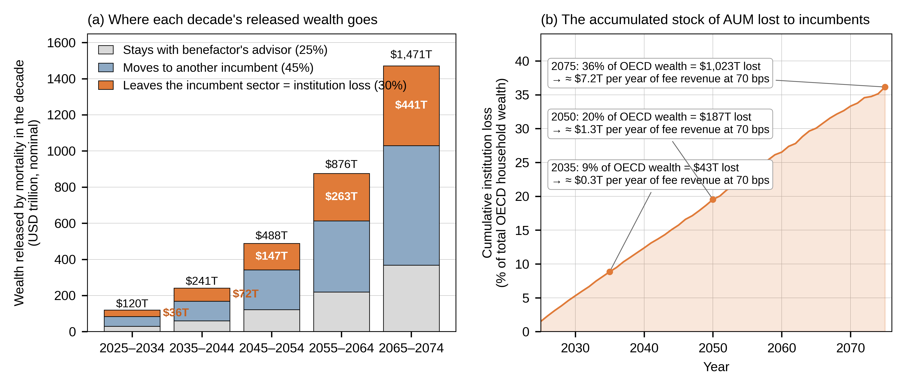

# The Bitcoin Intergenerational Wealth Framework

**A demographic floor for Bitcoin — and what the great wealth transfer does to the banking business model.**

[](https://github.com/fx14/bitcoin-intergenerational-wealth-framework/actions/workflows/reproduce.yml)
[](LICENSE)
[](LICENSE)

Model, derived data and replication code for

> Fuchs, K. L., Fuchs, W. M. (2026). *The Bitcoin Intergenerational Wealth Framework: A Demographic Floor for Bitcoin and the Reinvention of the Banking Business Model.* CVA Academic Research Journal 2026 — Crypto Valley Association CFP 2026, *On-Chain Finance and the Reinvention of Financial Infrastructure* (sub-theme: Business Models for Banks in Web3). Abstract accepted; full paper under review.

Everything in the paper's tables and model figures can be recomputed from this repository in under a minute. Every assumption is a named constant you can change.

## The idea in four sentences

Over the next decades the OECD's Boomer and Silent generations will pass on the order of USD 100 trillion to heirs whose portfolios look different from theirs. Demography is the most predictable force in finance: who is alive, how old they are, and when wealth changes hands are known decades ahead. We combine UN population projections, cohort wealth, mortality-driven inheritance and *population-representative* crypto allocations from central-bank surveys (not the inflated "share of investors" figures) into an annual flow-of-funds model for 2023–2100. Dividing that household demand by Bitcoin's tradable float gives a conservative **floor** for the price — below observed prices in every year so far — and the same engine measures the **assets under management that migrate away from incumbent banks** as clients die and heirs leave.

## Headline numbers (Medium scenario, nominal USD)

| | 2025 | 2050 | 2100 |
|---|---|---|---|
| Bitcoin demographic floor (Low / **Medium** / High) | 17k / **30k** / 51k | 136k / **238k** / 410k | 6.2M / **11.0M** / 20.8M |
| Observed spot (for comparison) | 87.5k | — | — |
| OECD wealth exposed to advisor attrition, per decade | 2.3% | 3.9% | — |
| Cumulative AUM lost to incumbents, % of OECD household wealth | — | 20% (≈ USD 187T) | 36% by 2075 |
| Recurring fee revenue on that lost stock, 70 bps | — | ≈ USD 1.3T / yr | ≈ USD 7T / yr by 2075 |

Medium CAGR 2023–2100: 8.2%. In 2023 purchasing power the 2100 Medium value is ≈ USD 2.4M.

<p align="center"></p>

## Quick start

```bash
git clone https://github.com/fx14/bitcoin-intergenerational-wealth-framework.git
cd bitcoin-intergenerational-wealth-framework
pip install -r requirements.txt
cd code && python3 reproduce_cva.py
```

`reproduce_cva.py` asserts the 30 values of Tables 3–4 **to the dollar** and the eight Table 6 sensitivity rows to <1%, then runs `aum_migration.py` (Table 7, Figs. 4 and 8) and `make_figures_cva.py` (Figs. 1, 2, 3, 5, 6, 7). Output goes to `output/` and `figures/`. The GitHub Action re-runs this on every push.

## The model

Equation (1) of the paper, computed year by year:

```
P_t = δ · Σ_g ( W_{g,t} · α_{g,t} ) / ( S_t − L_t − I_t )
```

| Symbol | Meaning | File |
|---|---|---|
| `W_{g,t}` | net worth of generation *g* in year *t* (USD trillion, 8 cohorts Silent → "Following") | `data/model_series.json["wealth"]` |
| `α_{g,t}` | unconditional crypto share of cohort net worth (participation × conditional weight) | `data/newscen.json` (low / med / high) |
| `δ = 0.66` | Bitcoin's share of crypto value | constant in `code/reproduce_cva.py` |
| `S_t − L_t` | circulating supply net of lost coins | `data/model_series.json["supply"]` |
| `I_t` | institutional and sovereign coins held off-market (≈1.5M in 2025, +3%/yr, capped at 5.0M) | `data/inst_params.json["ic"]` |

Institutions enter only through supply: their coins are removed from the float, but their purchasing power is never added to demand. The floor can therefore only be raised by them, never lowered — the model's single most conservative choice.

**The banking side** (`code/aum_migration.py`): wealth released by mortality each year (`data/inh_all.json`) → 75% is exposed to advisor attrition (Cerulli: only 27% of heirs intend to keep the benefactor's advisor) → 40% of that leaves the incumbent sector altogether (30% of released wealth = *institution loss*) → the running sum is the lost-AUM stock → × 60–80 bps is the recurring fee revenue in play. The constants `RETAIN`, `NET_LOSS`, `FEE_LO/MID/HI` sit at the top of the script.

### Scenarios — crypto share of cohort net worth (%)

| Generation | Low | Medium | High |
|---|---|---|---|
| Silent | 0.00 | 0.00 | 0.00 |
| Boomers | 0.03 | 0.05 | 0.10 |
| Gen X | 0.15 | 0.25 | 0.40 |
| Millennials | 0.40 | 0.70 | 1.20 |
| Gen Z | 0.80 | 1.50 | 2.80 |
| Gen Alpha | 1.00 | 1.80 | 3.40 |
| Gen Beta | 1.20 | 2.10 | 4.00 |
| Following | 1.40 | 2.40 | 4.60 |

These are **population** shares, anchored to OeNB (≈0.1% of Austrian household financial assets), ECB (≈0.23% euro area), Norges Bank, Bank of Canada and the Fed SCF — roughly two orders of magnitude below the investor-conditional weights (20–25% for Gen Z *investors*) that are often misapplied to whole cohorts. Post-Gen Z increments are stated directional assumptions.

## Repository layout

```
code/
  reproduce_cva.py                    asserts Tables 3, 4, 6; runs the two scripts below
  aum_migration.py                    Table 7, Fig. 4 attrition shares, Fig. 8 (banking side)
  make_figures_cva.py                 Figs. 1, 2, 3, 5, 6, 7 from the data
  oecd_population_parsing_CORRECTED.py  UN WPP 2024 → eight cohorts, no survival re-weighting (needs your own UN export)
data/
  model_series.json  newscen.json  inst_params.json  inh_all.json  comp.json
  MANIFEST.md                         provenance of every file
figures/                              regenerated figures (600 DPI)
output/                               tables_cva.txt, table7.txt
.zenodo.json  CITATION.cff  LICENSE  requirements.txt
```

## Use it for your own calculations

* Change allocation assumptions in `data/newscen.json` (eight cohorts, fraction of net worth) and re-run — the floor and every figure follow.
* Change `RETAIN`, `NET_LOSS` or the fee margin in `code/aum_migration.py` to size the AUM at risk for your own institution's retention record.
* Change the institutional path by editing `data/inst_params.json["ic"]`, or pass `cap=` / `lam=` to `price()` in `reproduce_cva.py` (as Table 6 does).
* Rebuild the population module from a fresh UN WPP export with `oecd_population_parsing_CORRECTED.py`, then regenerate `model_series.json` with your own wealth calibration.

All numbers are **nominal USD** unless stated; deflate with 2%/yr (×1/4.59 at 2100) for 2023 purchasing power.

## Data provenance and limits

Only **derived** series are redistributed; raw UN, OECD and central-bank microdata are not (see `data/MANIFEST.md`). The model is a deterministic accounting framework, not a market-clearing equilibrium: it is built to under-estimate demand (OECD only, representative allocations, forced rebalancing, institutions excluded from demand) and should be read as a floor, not a forecast. Known limitation disclosed in the paper: the custodial vs self-custody split of migrating assets is not identifiable from public data.

## Citation

```bibtex
@article{fuchs2026biwf,
  title   = {The Bitcoin Intergenerational Wealth Framework: A Demographic Floor for Bitcoin and the Reinvention of the Banking Business Model},
  author  = {Fuchs, Klaus L. and Fuchs, Winnie M.},
  journal = {CVA Academic Research Journal},
  year    = {2026},
  note    = {Crypto Valley Association CFP 2026 -- On-Chain Finance and the Reinvention of Financial Infrastructure}
}
```

Software/data: see `CITATION.cff`. A Zenodo DOI for this repository is created from `.zenodo.json` on the first GitHub release.

## License

Code: [MIT](LICENSE). Data and figures: [CC BY 4.0](LICENSE). © 2026 Klaus L. Fuchs, Winnie M. Fuchs.

## Related

The demographic engine is shared with a separately framed paper by the authors on the exogeneity of demand floors (Zenodo [10.5281/zenodo.21584815](https://doi.org/10.5281/zenodo.21584815)). That package carries different tables, figures and code; this repository is the complete record for the CVA paper.

## Contact

Klaus L. Fuchs — klaus.fuchs@alumni.ethz.ch — ORCID [0000-0003-3226-920X](https://orcid.org/0000-0003-3226-920X)
